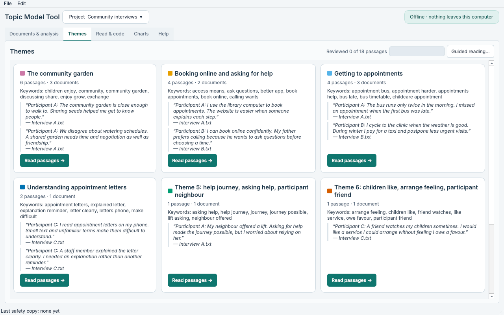
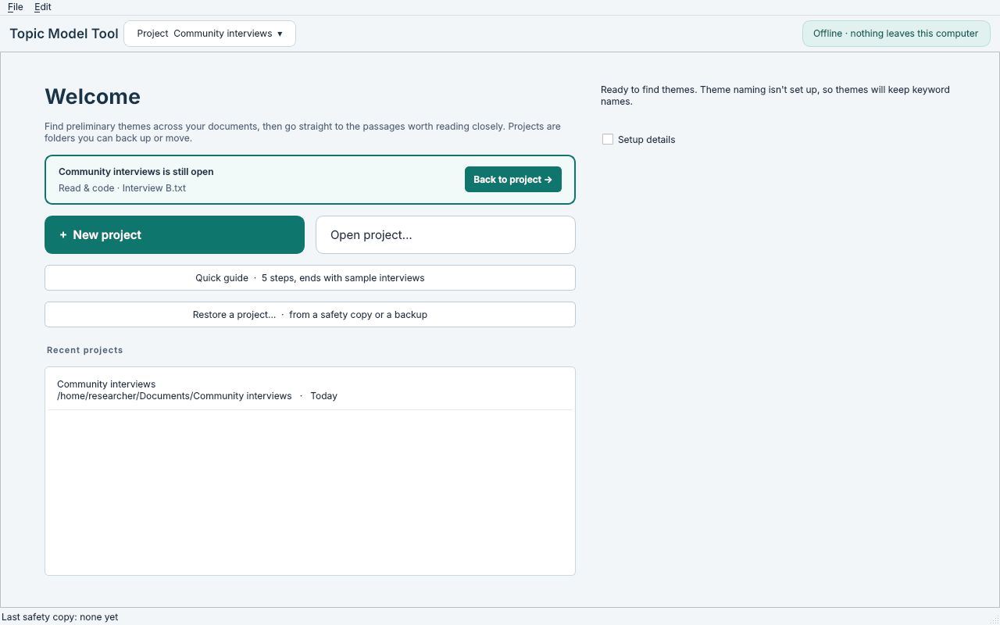
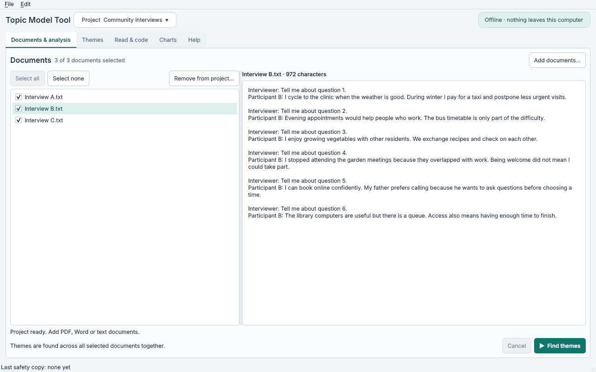
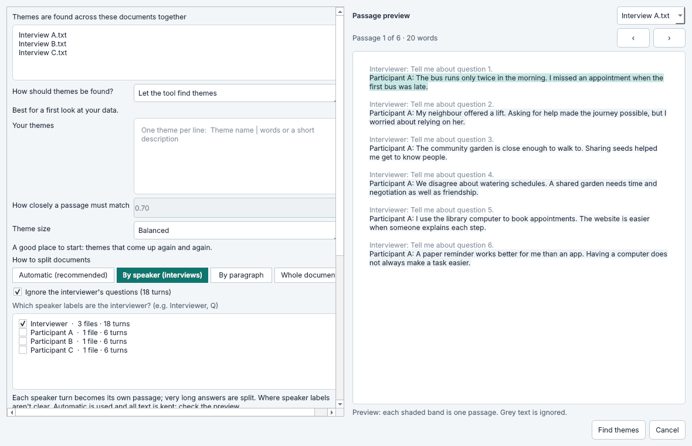
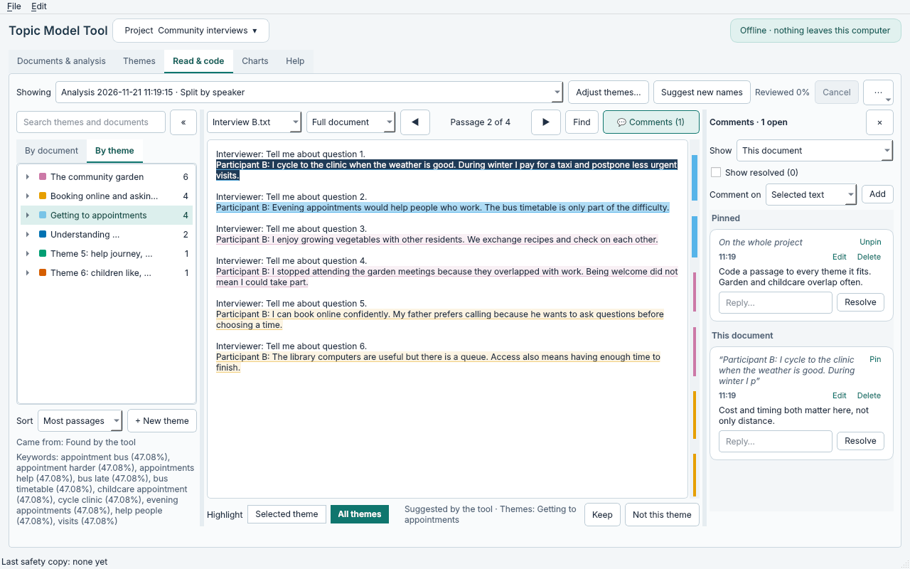

# Topic Model Tool

A desktop app for finding preliminary themes across interviews and other documents, then reading and coding the passages behind them. I built it for researchers who don't write code: you add your documents, press ▶ Find themes, and go straight to the passages worth reading closely.

Everything runs on your computer. The installer includes the models it needs, the app works without an internet connection, and your documents never leave your machine.



## Install

1. Open the [latest release](../../releases/latest) and download the file for your computer:
   - **Windows 10 or 11:** `TopicModelTool-Setup-<version>.exe`
   - **Mac with Apple silicon (M1 or newer):** `TopicModelTool-<version>-macOS-arm64.dmg`
   - **Optional, for readable theme names:** every part of the naming model (`naming-model-llama3.1-8b.tmtpack.001`, `.002`, `.003`, about 4.9 GB together). GitHub limits files to 2 GB, so it comes in parts; keep them in one folder. On Windows, put them next to the installer and they're installed with the app.
2. Double-click the file and follow the steps.

Windows and macOS warn you the first time because the app isn't sold through an app store. [How to open it the first time](docs/FIRST_OPEN.md) covers the few clicks. For a lab without internet, copy the installer and the model parts onto a USB drive.

Theme naming works best with 16 GB of memory. Without the naming model, themes are named by their keywords and everything else works the same.

## How it works

The start screen has a **Quick guide** with the five steps below, and it ends with a set of sample interviews you can practise on.



1. **Add documents.** Start a **New project** and add PDF, Word (`.docx`) or text files. The project keeps its own copy, so your originals stay where they are. Scanned PDFs need OCR first.
2. **Check the text.** On **Documents & analysis**, click each document and look for missing text, broken paragraphs and speaker labels.

   

3. **Find themes (optional).** Tick the documents you want and press **▶ Find themes**. You can let the tool find themes, nudge it with keywords you expect, or start from your own list of themes (like a codebook). For interviews, **By speaker** keeps each speaker's turn together and can ignore the interviewer's questions. The preview shows exactly how each document will be split.

   

   The **Themes** tab then shows a card for each theme: its keywords, how many passages and documents it covers, and two example quotes.
4. **Read & code.** Select text and press a number key or pick a theme (Ctrl+Q). Suggested passages show **Keep** / **Not this theme**. Add comments on a passage, a theme, a document or the whole project, and pin the ones you want to keep in view. Coding and comments work without any AI.

   

5. **Export your work.** **File → Export** has a codebook (CSV or JSON), your coded passages (CSV), a reading guide (Word) and everything in one Excel workbook.

Treat the themes as places to start reading, not findings. They depend on your text and settings, and a different seed can give a different grouping.

### A few things worth knowing

- **Small collections work.** With about 30 passages or fewer, every passage gets a theme. Two passages is the minimum.
- **Number of themes.** "Let the tool decide" or "About N"; **At most** (up to 100) combines similar themes once they're found.
- **More options** in Find themes covers keyword style, words to ignore, how many passages stay unsorted, merging similar themes and the random seed. **Reset to recommended** puts them back, and **About this analysis** (in the ⋯ menu) lists every setting a run used.
- **Adjust themes** refines an existing analysis: new keywords, new names, fewer themes or a fresh run. Your coding is kept.
- **Charts** has a passage map, theme similarity and a theme tree.
- **Search all documents** (Ctrl+Shift+F) and **Find in document** (Ctrl+F) are in the Edit menu, along with undo for coding.

## Theme naming

With the naming model installed, a local language model (Llama 3.1 8B) suggests readable names after themes are found. It runs in a private copy of Ollama that the app starts and stops itself and that only this computer can reach. You can keep reading and coding while names are filled in. If you rename a theme yourself, naming leaves it alone.

To add the model later, open **Setup details** on the start screen, choose **Add theme-naming model…**, and pick the `.tmtpack.001` file (the other parts must be in the same folder).

If naming fails, the status line says why. The usual cause is not enough free memory, so close other large programs and choose **Suggest new names** again. On a computer without a suitable graphics card, naming runs on the processor; it's slower, and the app gives a time estimate for large runs.

Llama 3.1 is licensed under the Llama 3.1 Community License, Copyright © Meta Platforms, Inc. Built with Llama.

## Your projects

A project is a folder holding `project.sqlite` (documents, coding, comments and saved analyses) and `sources/` (copies of your documents). The models are installed with the app and shared by every project.

- **File → Back up project…** writes a checked `.tmtbackup` file. Store it somewhere other than the project's disk.
- **Daily safety copies** are made automatically while a project is open and idle, and the last seven are kept beside the project. Turn them off or make one now from the File menu.
- **File → Restore a project…** restores either one into a new folder. It never overwrites an existing project.

Backups and safety copies aren't encrypted, so store them the way your research data rules require. Keep private projects and exports out of any Git repository.

Projects made with the 0.2 test versions don't open in 0.3. See the [changelog](CHANGELOG.md).

## Run from source

I develop on Python 3.12. From the repository root:

```bash
python -m venv .venv
source .venv/bin/activate          # Windows: .venv\Scripts\Activate.ps1
python -m pip install -e ".[analysis,test]"
python scripts/fetch_resources.py  # once, while online: the embedding model and the naming engine
doc-topic-model-tool
```

Add `--skip-engine` to `fetch_resources.py` if you'd rather use an Ollama you already run; naming then uses that one. `doc-topic-model-tool --self-test` checks the installation (the installer runs it too), and `python -m pytest -q` runs the tests. `examples/smoke_corpus/` has a few small documents for trying it without real data.

- [docs/ARCHITECTURE.md](docs/ARCHITECTURE.md): how the code fits together. Start here if you're new to it.
- [docs/BUILDING.md](docs/BUILDING.md): building the installers and model packs.
- [CHANGELOG.md](CHANGELOG.md): what changed in each version.
